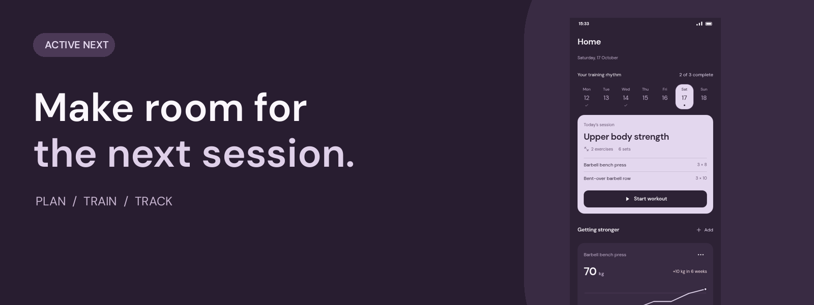
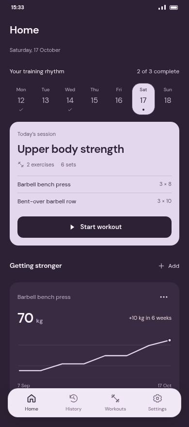
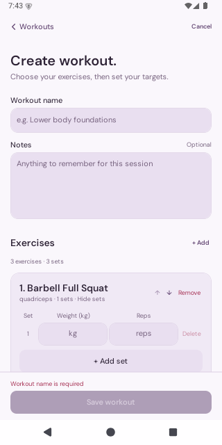
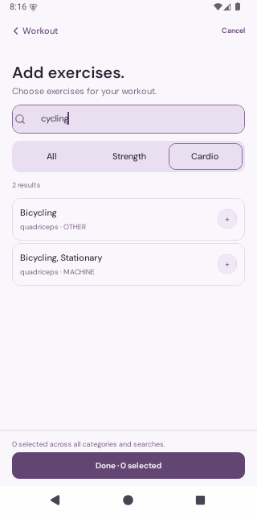

<div align="center">
  

  <p></p>

# Active Next

**Plan your training. Log the work. See how far you've come.**


[Get it on Google Play](https://play.google.com/store/apps/details?id=com.alexspx.activenext) · [Roadmap](#roadmap) · [Explore the landing page](https://alexspx.github.io/active-app/) · [Get started](#get-started) · [Project layout](#project-layout)

</div>

Active Next is [available on Google Play](https://play.google.com/store/apps/details?id=com.alexspx.activenext) for Android. iOS is a supported development target.

Active Next is built with Expo and React Native for Android and iOS. The native app starts with a local profile and keeps training data on the device, so a workout does not depend on a connection or an account.

[Landing page](https://alexspx.github.io/active-app/) · [Landing page development](apps/site/README.md) · [Promotional video](tools/promo/README.md)

## Your training, in one place

### Plan a routine

Build workout templates with exercises, sets, reps, and weights. Group workouts into routines to give your training a repeatable schedule. Choose a sequential routine or complete sessions flexibly within the week, and track current and longest streaks. The home screen brings the day's plan and exercise progress together.

### Find the right exercise

Browse the exercise collection, search the catalog, and filter by muscle group or equipment. Explore muscles with the muscle atlas and open exercise details before choosing movements for your workouts.

### Focus on the session

Start a workout, check off sets as you complete them, and keep track of elapsed time. A configurable rest timer helps you move between sets without watching the clock.

### Look back and move forward

Browse your workout history, see personal records, and follow exercise progression over time. Customize the app with theme, body measurement, time zone, and notification settings. Android and iOS home-screen widgets show today's plan. Settings are available from the header.

## Roadmap

- **Self-hostable:** run your own backend to manage accounts and training data, with workout import and synchronization planned. Follow the [Rust API development](services/api/README.md).
- **Web app:** bring workout planning, logging, and progress tracking to the browser.
- **Exercise icons and GIFs:** make the exercise collection easier to scan and add visual movement demonstrations.
- **Wearables:** explore watch support for logging sets and following workouts from your wrist.
- **Potential local AI coach:** investigate on-device coaching informed by training history, with offline use and device performance in mind. This is exploratory work, not a released feature.

These are planned directions; scope and release dates are still open.

## A look inside

<div align="center">
  
  
  
</div>

<p align="center"><em>Home screen design preview · Workout editor · Exercise search</em></p>

The home screen is an illustrative design preview with sample data. The other images are Android emulator captures.

## Get started

See [Android Maestro regression testing](docs/testing/android-maestro.md) for local and CI commands.

You need Node.js 24.6.0, Yarn, and the platform tools for your target device. Android development requires Android Studio and an emulator or device; iOS development requires macOS and Xcode. Native builds use an Expo development client and include custom native modules.

```sh
yarn install
yarn android   # Build and run on Android
yarn ios       # Build and run on iOS
```

After installing a development build, start Metro with `yarn start`. Use `yarn start:clear` if you need to clear its cache. Both commands limit Metro to two workers.

Native accounts, backend access, and sync are currently disabled by the launch policy in [`config/launchPolicy.ts`](apps/client/config/launchPolicy.ts).

## Stack

| Area                 | Technology                               |
| -------------------- | ---------------------------------------- |
| App and routing      | Expo SDK 58, React Native, Expo Router   |
| UI                   | Uniwind, Tailwind CSS 4, Lucide, DM Sans |
| State and data       | TanStack Query, Zustand, SQLite          |
| Forms and validation | React Hook Form, Zod                     |
| Tests                | Jest, jest-expo                          |

## Project layout

| Path                   | Purpose                                                                     |
| ---------------------- | --------------------------------------------------------------------------- |
| `apps/client/`         | Expo Android and iOS application, including feature workflows and shared UI |
| `apps/site/`           | Static landing site and legal source                                        |
| `services/api/`        | Rust API and SQLite storage for self-hosting                                |
| `contracts/v1/`        | Versioned API contract                                                      |
| `packages/api-client/` | Generated TypeScript API client                                             |
| `tools/promo/`         | Remotion video tooling                                                      |
| `scripts/`             | Shared legal generation and checks                                          |
| `docs/`                | Project documentation                                                       |

Feature modules own their workflows and data access. Router screens compose those workflows, and shared UI components receive data and callbacks through props. `apps/client/global.css` defines the shared design tokens.

## Commands

| Command                     | Purpose                                                    |
| --------------------------- | ---------------------------------------------------------- |
| `yarn start`                | Start the Expo development server                          |
| `yarn start:clear`          | Start Metro with a cleared cache                           |
| `yarn android` / `yarn ios` | Build and run the native app                               |
| `yarn test`                 | Run Jest in watch mode                                     |
| `yarn test:once`            | Run the Jest suite once                                    |
| `yarn test:sync`            | Run the sync tests                                         |
| `yarn format:check`         | Check formatting with Prettier                             |
| `yarn format`               | Format the repository with Prettier                        |
| `yarn legal:sync`           | Generate app legal content from the landing page documents |
| `yarn legal:check`          | Test the legal content generator and check generated files |

Run `yarn typecheck` and `yarn site:check` for additional checks. Use `yarn promo:studio`, `yarn promo:render`, or `yarn promo:poster` for the video project. Run EAS commands from `apps/client` after installing at the root.

The legal documents in `apps/site/legal/` are the source of truth. After editing them, run `yarn legal:sync` and commit the generated files. See the [landing page README](apps/site/README.md) for publishing and verification instructions.

## Android releases

Add the `Release` label to a pull request before merging it into `master` to trigger
`.github/workflows/eas-release.yml`. The workflow builds the merged commit with the EAS
`production` profile and automatically submits it to Google Play using the matching submission
profile. Closed, unmerged pull requests and merges without the label do not trigger a build.

The workflow uses the repository's `EXPO_TOKEN` Actions secret. Android signing credentials and
Google Play submission credentials must already be configured in EAS for non-interactive use.
The current `eas.json` submits a draft to the internal testing track; publish the release from
Google Play Console to distribute it to testers. Build numbers increment automatically.
