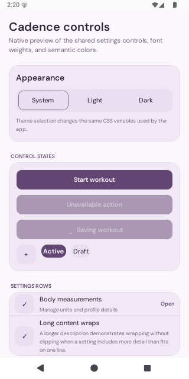
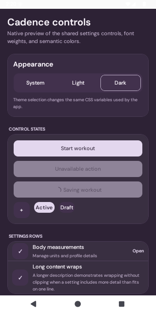
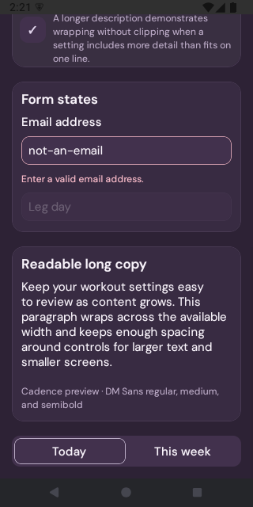

# Cadence shared controls verification

ALE-97 starts from freshly fetched `origin/master` at `892459e`.

The existing Android development client rendered the isolated component preview on `emulator-5554`. No client rebuild or installation was needed. Light and dark appearance, loading and disabled buttons, grouped rows, field errors, long content, and 1.3× system text were inspected. The emulator text scale was restored to 1.0 afterward.

Run the preview outside the production route tree with `PORT=8083 ./scripts/preview-cadence-native.sh`. The launcher temporarily changes the package entry, rejects overlapping preview launches, and restores the entry on exit. Stop it before running the production app. After an unclean termination, inspect `package.json.main` and `.cadence-preview.lock` before restarting.

TypeScript, Prettier, and `git diff --check` passed. The settings, control, design-config, and provider-theme Jest suites passed all 25 tests. An isolated launcher fixture checked failure cleanup, repeated launches, overlap rejection, preservation of concurrent package edits, and rejection of an already-active preview entry.

This earlier control review covered the staged migration only.

