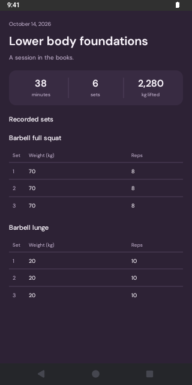
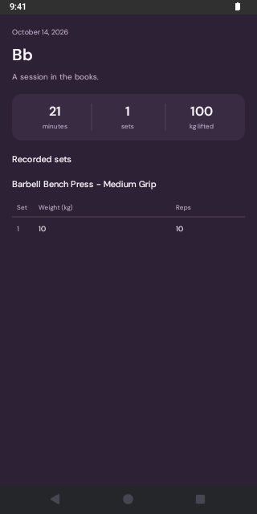

# Verify the native History record layout

The native preview renders `RecordDetailView` with the mock's 38-minute, six-set record. It uses the installed development client without changing workout data.

Start the preview:

```bash
PREVIEW_MAIN=components/dev/history-preview/entry.tsx PORT=8083 ./scripts/preview-cadence-native.sh
```

Open the preview on Android, then capture its visible bounds and pixels:

```bash
adb -s emulator-5554 reverse tcp:8083 tcp:8083
agent-device open com.alexspx.activenext 'activenext://expo-development-client/?url=http%3A%2F%2F127.0.0.1%3A8083' --platform android --foreground
agent-device wait text 'Lower body foundations' 45000
agent-device snapshot --json > /tmp/history-layout.json
agent-device screenshot /tmp/history-layout.png
python3 scripts/verify-history-preview.py /tmp/history-layout.json /tmp/history-layout.png
```

The checker requires Python and Pillow. It checks actual Android column alignment, section spacing, and both visible summary dividers. The full mock record must be visible; use the emulator's default text scale. The checker passes on the corrected screen and fails on the earlier native screenshot because its summary dividers are missing.

Restart the launcher with `EXPO_PUBLIC_HISTORY_PREVIEW_CASE=single` to inspect the reported `Bb` record and long bench-press name, or `EXPO_PUBLIC_HISTORY_PREVIEW_CASE=cardio` for interval durations. Inspect those cases visually; the automated check uses the default mock record.

Stop the launcher when finished. It restores the original package entry.




